<div align="center">


# Vessel

**极简、透明、云原生的 Docker Compose 自部署应用与数据库管理平台**

以原生 `docker-compose.yml` 为一等公民，内置 **Caddy v2 自动 HTTPS 反代**、**六大受管数据库一键交付**、**版本快照回滚与 Webhook**、**Cloudflare R2 三层加密灾备** 以及 **72h 冷却保护的 Docker 安全瘦身引擎**。

[](https://github.com/SpeedupMaster/vessel/releases)
[](LICENSE)
[](https://www.docker.com/)
[](https://nodejs.org/)
[](https://react.dev/)
[](https://caddyserver.com/)

[⚡ 一键安装](#-快速开始一键安装) · [🖼️ 界面预览](#️-界面预览与核心功能) · [🏗️ 系统架构](#️-系统架构) · [💾 灾备机制](#-三层数据备份与原子恢复语义) · [🔄 版本升级](#-版本升级)

</div>

---

<picture>
  <source media="(prefers-color-scheme: dark)" srcset="docs/screenshots/overview-dark.png" />
  <source media="(prefers-color-scheme: light)" srcset="docs/screenshots/overview-light.png" />
  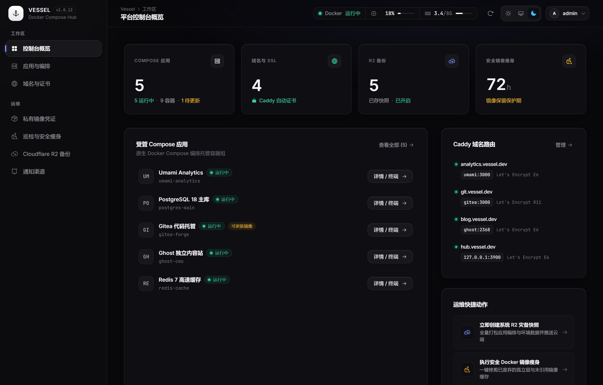
</picture>

<details>
<summary>🌞 点击展开查看 <b>浅色主题 (Light Mode)</b> 控制台预览</summary>
<br />
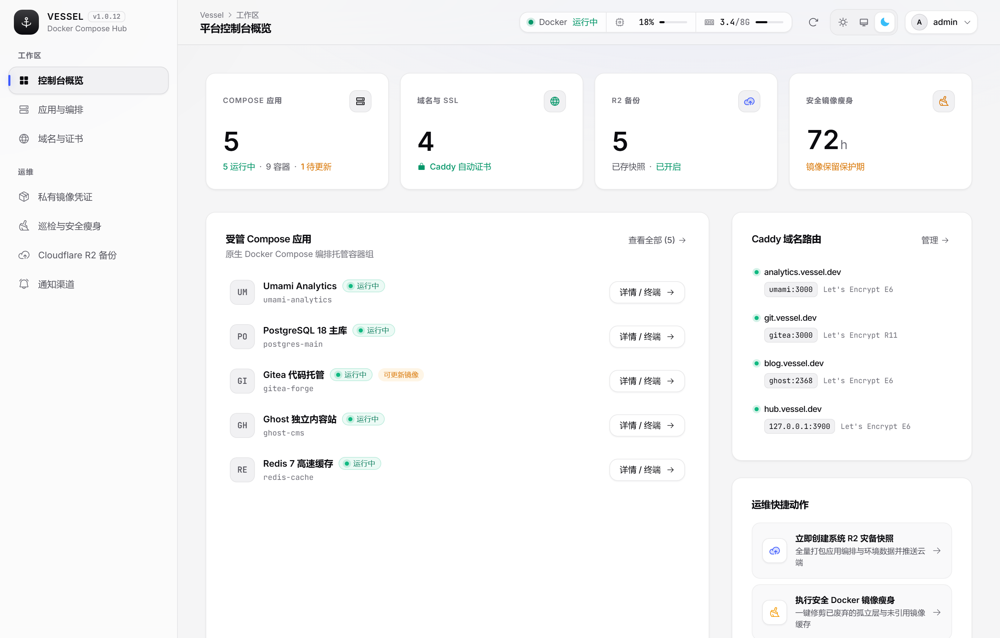
</details>

---

## 📑 目录

- [🎯 为什么选择 Vessel](#-为什么选择-vessel)
- [🖼️ 界面预览与核心功能](#️-界面预览与核心功能)
  - [1. 原生 Docker Compose 编排工作台](#1-原生-docker-compose-编排工作台)
  - [2. 部署历史、配置回滚与 CI/CD Webhook](#2-部署历史配置回滚与-cicd-webhook)
  - [3. 六大受管数据库一键交付与在线终端](#3-六大受管数据库一键交付与在线终端)
  - [4. Caddy v2 动态反向代理与真实证书探针](#4-caddy-v2-动态反向代理与真实证书探针)
  - [5. Cloudflare R2 三层加密灾备体系](#5-cloudflare-r2-三层加密灾备体系)
  - [6. 镜像更新巡检、磁盘透视与 72h 安全阶梯清理](#6-镜像更新巡检磁盘透视与-72h-安全阶梯清理)
  - [7. 多渠道事件通知与面板一键自更新](#7-多渠道事件通知与面板一键自更新)
- [🏗️ 系统架构](#️-系统架构)
- [⚡ 快速开始（一键安装）](#-快速开始一键安装)
- [⚙️ 自定义参数与多发行版矩阵](#️-自定义参数与多发行版矩阵)
- [🐳 生产部署与本地开发](#-生产部署与本地开发)
- [🔄 版本升级](#-版本升级)
- [💾 三层数据备份与原子恢复语义](#-三层数据备份与原子恢复语义)
- [🧪 自动化测试与验证](#-自动化测试与验证)
- [📁 项目目录结构](#-项目目录结构)
- [📄 开源协议](#-开源协议)

---

## 🎯 为什么选择 Vessel

传统的服务器面板往往重度侵入系统环境、把容器封装在私有黑盒配置中；而纯粹手写命令又缺乏证书管理、数据卷灾备、部署回滚与状态可观测性。**Vessel** 专为追求**简洁、可控、生产可靠**的开发者与运维团队打造：

| 维度 | 传统重型面板 | 纯手工 CLI 运维 | **Vessel 控制台** |
| :--- | :--- | :--- | :--- |
| **编排透明度** | 私有模板与黑盒配置，难以迁移 | 原生 `docker-compose.yml` | **100% 原生 `docker-compose.yml` + `.env`**，随时可脱离面板独立运行 |
| **HTTPS 与反代** | 需手动维护 Nginx 配置与 Certbot | 手动编写反代与续期脚本 | **内置 Caddy v2 动态 API**，零重启绑定域名，自动签发/续期证书并探测真实 TLS 状态 |
| **版本回滚与 CI** | 缺少配置级版本历史 | 依赖外部脚本记录 | **单调递增部署快照 (`#1, #2...`)**，支持一键回滚、失败自动回滚与独立 Webhook 触发 |
| **数据库交付** | 需装插件或手动写挂载与凭据 | 手动配置端口、密码与转储 | **一键交付 PG 18 / MySQL / MariaDB / Mongo / Redis / libSQL**，自带 Web 终端与单库逻辑备份 |
| **数据灾备** | 仅打包面板目录，遗漏 Docker 卷 | 需自行编写停机挂载归档脚本 | **AES-256-GCM 系统加密快照 + 真实数据卷容器归档 + 数据库逻辑转储**直传 Cloudflare R2 |
| **磁盘清理安全** | 粗暴执行 `docker system prune -a` | 容易误删回滚所需的近期镜像 | **按镜像失去容器引用时间计算 72h 冷却期**，可视化透视镜像/容器/数据卷/构建缓存与容器日志占用 |

---

## 🖼️ 界面预览与核心功能

### 1. 原生 Docker Compose 编排工作台

- **零黑盒封装**：每个应用对应独立隔离的工作区目录（`${DATA_DIR}/apps/<app-id>`），直接读写原生 `docker-compose.yml` 与 `.env`，相对路径挂载自动映射到宿主机持久化目录。
- **在线代码编辑器**：内置行号对齐、YAML 语法实时校验、一键格式化与配置预览。
- **全生命周期控制**：支持启动、停止、重启、强制拉取重建（`--pull always`）以及危险操作二次确认的**重置数据卷 (`down -v`)**。

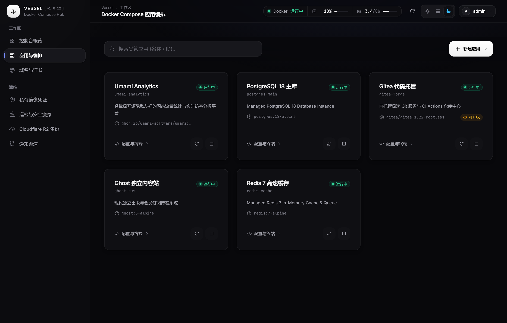

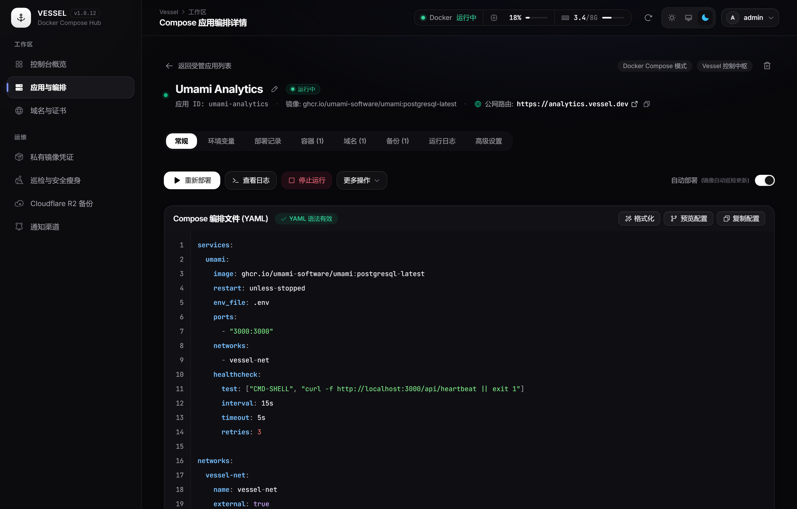

---

### 2. 部署历史、配置回滚与 CI/CD Webhook

- **完整部署留痕**：每次手动部署、Webhook 触发、自动更新或回滚都会生成独立编号记录（`#1, #2...`），持久化保存完整彩色终端日志、当时的 `docker-compose.yml` 与 `.env` 快照、镜像 Digest 及耗时。
- **一键回滚与故障自愈**：可随时对比历史配置并一键回滚至任意成功版本；开启「失败时自动回滚」后，若新版本容器启动或健康检查失败，系统将自动恢复上一版可用配置。
- **应用级 CI/CD Webhook**：每个应用可开启带随机高强度密钥的 Webhook 接口。在 GitHub Actions / GitLab CI 推送镜像后，仅需一行请求即可触发拉取重建：
  ```bash
  # 拉取最新镜像并重建容器（默认动作 rebuild）
  curl -X POST "https://<您的面板域名>/api/hooks/deploy/<应用ID>/<Webhook密钥>"

  # 仅按当前保存的 Compose 配置执行部署
  curl -X POST "https://<您的面板域名>/api/hooks/deploy/<应用ID>/<Webhook密钥>?action=deploy"
  ```
- **精细化部署策略**：支持按应用配置镜像拉取策略（`always` / `missing`）、清理孤儿容器（`--remove-orphans`）、等待健康检查就绪（`--wait`）与超时熔断。

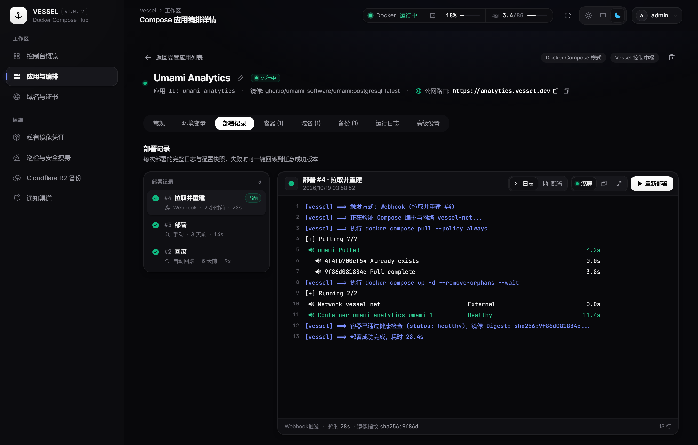

---

### 3. 六大受管数据库一键交付与在线终端

除自定义 Compose 应用外，Vessel 支持一键创建并托管 6 种主流数据库实例：

- **支持引擎**：**PostgreSQL 18**（自动适配 PG 18+ 新版 `/var/lib/postgresql` 数据卷路径与旧版兼容）、**MySQL 8**、**MariaDB 11**、**MongoDB 7**、**Redis 7**、**libSQL (Turso)**。
- **开箱即用凭据管理**：自动生成密码学安全的随机密码或 libSQL JWT Token，直观展示并支持一键复制**容器内网连接串（`vessel-net`）**与**宿主机外网连接串**，支持随时在线开启/关闭外网映射端口。
- **内置 Web 交互式数据库终端**：无需 SSH 登录服务器，直接在浏览器内打开交互式命令行终端（自动连接 `psql`、`mysql`、`mariadb`、`mongosh`、`redis-cli`）。
- **容器级健康诊断监控**：实时读取 Docker Engine 容器状态、退出码语义解析（如 `OOMKilled` / `SIGKILL 137`）、Healthcheck 连续失败次数、挂载卷与网络拓扑。

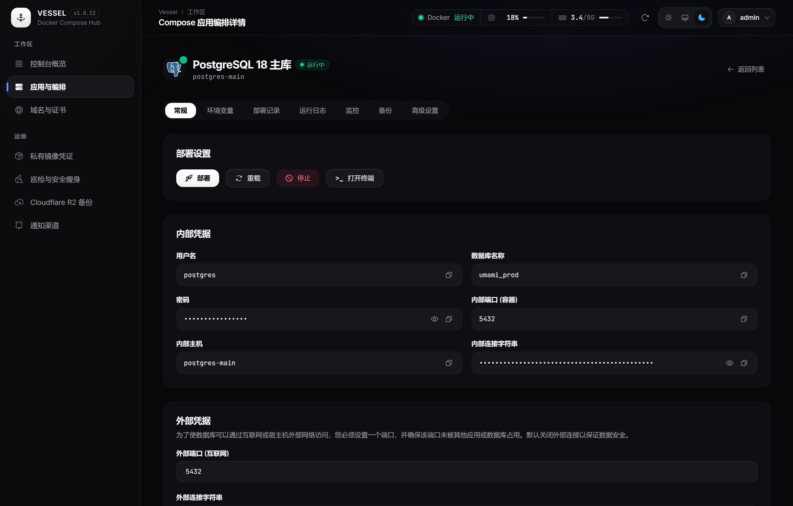

---

### 4. Caddy v2 动态反向代理与真实证书探针

- **REST API 动态热挂载**：内置 Caddy v2 服务，添加、修改或解绑域名均通过管理接口热更新路由，全程零重启、不中断现有连接。
- **全自动 HTTPS 与真实 TLS 探针**：自动通过 Let's Encrypt / ZeroSSL 申请并续订 SSL 证书；后端通过 TLS 握手直接探测运行中 Caddy 的真实证书签发机构（Issuer）与到期时间。
- **双模式上游与智能端口识别**：
  - **容器内部网络 (`vessel-net`)**：直接通过「服务名 + 容器端口」转发，无需将业务端口暴露到宿主机公网。
  - **宿主机端口 (`127.0.0.1`)**：转发至宿主机已映射端口，或一键将域名绑定至 Vessel 控制台自身（`vessel-system:3900`）。
  - 自动解析 Compose 中的 `ports`（短语法/长语法）与 `expose` 声明，在绑定域名时提供端口快捷点选。

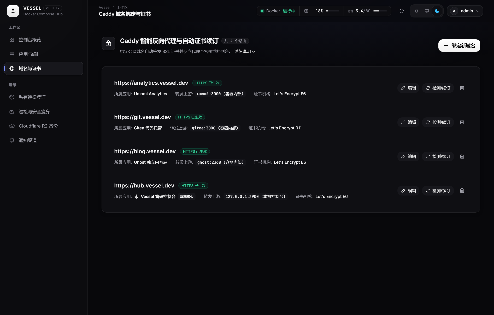

---

### 5. Cloudflare R2 三层加密灾备体系

- **S3 兼容对象存储直传**：原生对接 Cloudflare R2，支持自定义 Cron 定时备份周期、保留份数自动轮转淘汰（Retention）与一键连通性测试。
- **AES-256-GCM 系统快照加密**：设置备份口令后，系统全量快照在打包上传前均经 PBKDF2 密钥派生与 **AES-256-GCM** 认证加密，跨服恢复时需验证口令方可解密。
- **三层全覆盖归档**：同时管理**系统级配置快照**、**应用真实数据卷归档**与**数据库单库逻辑转储**，支持在线下载归档或从本地备份文件带实时进度条上传恢复。

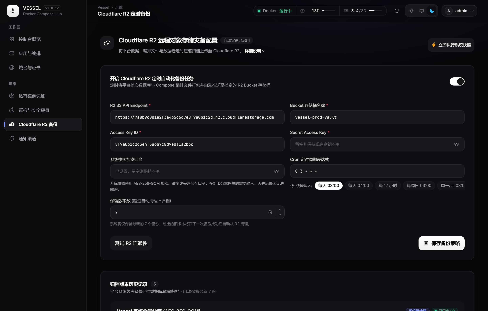

---

### 6. 镜像更新巡检、磁盘透视与 72h 安全阶梯清理

- **远程 Registry Digest 巡检**：按设定 Cron 周期比对远程镜像仓库（Docker Hub / GHCR）最新 Digest 与本地运行容器，发现更新时高亮标记，并为开启「自动升级」的应用执行无感拉取重建。
- **72h 引用丢失冷却保护**：记录镜像**从不再被任何容器引用那一刻起**的时间戳，仅清理悬空满冷却期（默认 72 小时）的镜像与构建缓存，绝不误删刚更新替换下来、可能用于紧急回滚的旧镜像。
- **Docker 磁盘占用分布透视**：直观展示**镜像、容器、本地数据卷、BuildKit 构建缓存**的数量、总占用与可回收空间占比，并列出体积最大的容器 JSON 日志文件（超 100 MB 自动预警）。

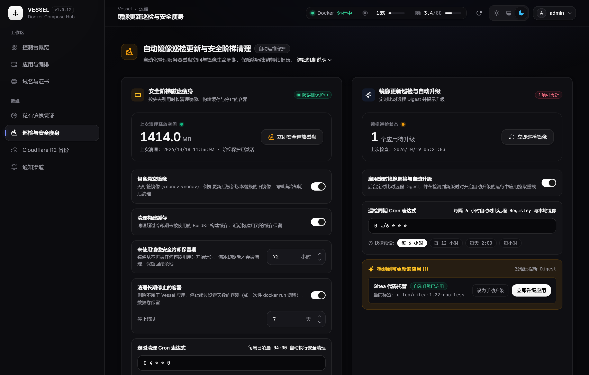

---

### 7. 多渠道事件通知与面板一键自更新

- **五大通知渠道**：原生集成 **飞书群机器人**、**钉钉群机器人**、**企业微信群机器人**、**Telegram Bot** 与 **通用 JSON Webhook**，支持按渠道订阅「部署失败」「部署成功」「发现新版本镜像」「定时备份失败」事件并一键发送测试消息。
- **私有镜像仓凭证管理**：支持配置 GitHub Container Registry (`ghcr.io`) 与 Docker Hub 凭证，一键验证连通性并自动注入 Docker 认证上下文。
- **面板一键在线自更新 (Self-Update)**：侧边栏自动检测 GitHub Release 新版本，支持在 Web 控制台内一键触发拉取新镜像并通过独立 Updater 容器平滑替换重启，更新失败自动回滚。

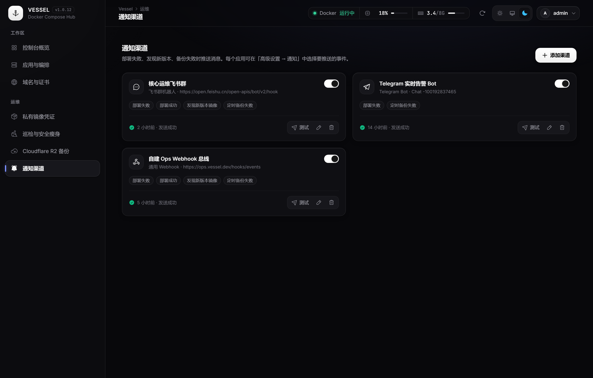

---

## 🏗️ 系统架构

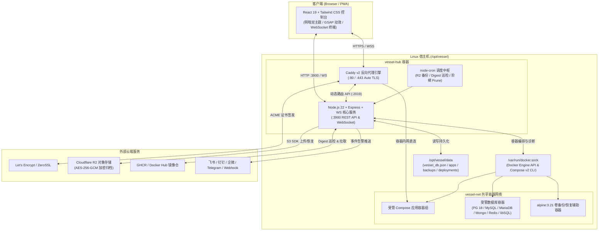

### 技术栈一览

- **前端控制台**：React 19 + Vite 6 + TypeScript + Tailwind CSS + GSAP + Phosphor Icons + PWA Service Worker
- **后端核心**：Node.js 22 LTS + TypeScript + Express + WebSocket (`ws`) + `dockerode` + `yaml` + `node-cron`
- **反向代理与网关**：Caddy v2（动态 JSON 配置 API + 自动 ACME TLS + 真实握手证书探测）
- **加密与存储**：Node WebCrypto / `crypto`（`scrypt` 密码哈希、`AES-256-GCM` 快照加密）+ AWS S3 SDK（Cloudflare R2）+ `archiver`
- **工程架构**：pnpm Workspace Monorepo + 多阶段 Alpine 生产镜像构建

---

## ⚡ 快速开始（一键安装）

### 环境要求

- **操作系统**：Linux `x86_64 (amd64)` 或 `aarch64 (arm64)`（支持 Debian、Ubuntu、RHEL、CentOS、Rocky、AlmaLinux、Fedora、Alpine、openSUSE 等）
- **权限要求**：`root` 用户或具备 `sudo` 权限的账号
- **端口要求**：宿主机 TCP `80`、`443`（供 Caddy 反代与签发证书）以及 `3900`（Web 控制台端口，可通过环境变量自定义）

### 推荐在线一键安装

在终端执行以下命令，安装器将自动完成系统检测、补齐缺失的 Docker / Compose v2 插件、创建 `vessel-net` 网络并启动服务：

```bash
curl -fsSL https://github.com/SpeedupMaster/vessel/releases/latest/download/install.sh | sudo sh
```

> [!TIP]
> 若当前已是 `root` 用户，可将 `sudo sh` 简写为 `sh`。参数 `-f` 确保遇到 HTTP 错误时不将错误响应页当作脚本执行。

### 分步下载与 SHA-256 完整性校验安装

在对安全审计要求较高的生产环境中，建议先下载安装脚本与校验清单并核对哈希：

```bash
# 1. 下载最新版本（或指定版本如 v1.0.12）的安装脚本与哈希清单
curl -fSL https://github.com/SpeedupMaster/vessel/releases/latest/download/install.sh -o install.sh
curl -fSL https://github.com/SpeedupMaster/vessel/releases/latest/download/SHA256SUMS -o SHA256SUMS

# 2. 校验脚本完整性
sha256sum -c SHA256SUMS

# 3. 执行安装
sudo sh install.sh
```

### 首次登录与初始密码获取

安装完成后，在浏览器打开：`http://<服务器公网IP>:3900`

- **默认管理员账号**：`admin`
- **查看随机生成的初始密码**：
  ```bash
  sudo cat /opt/vessel/data/initial-admin-password
  ```
- **强制改密安全机制**：首次使用初始随机密码登录后，控制台会**强制要求立即修改密码**（至少 8 位）。修改成功后，系统会自动销毁 `/opt/vessel/data/initial-admin-password` 文件。
- **无交互预设密码**：若在自动化脚本中部署，可在首次启动前设置环境变量 `VESSEL_ADMIN_PASSWORD`（不少于 8 位字符）以跳过初始密码文件流程。

---

## ⚙️ 自定义参数与多发行版矩阵

### 安装脚本环境变量

通过 `sudo env` 向安装脚本注入环境变量，可按需定制安装路径、控制台端口与镜像源：

```bash
curl -fsSL https://github.com/SpeedupMaster/vessel/releases/latest/download/install.sh | \
  sudo env VESSEL_INSTALL_DIR=/opt/vessel VESSEL_PORT=4390 sh
```

| 环境变量 | 默认值 | 说明 |
| :--- | :--- | :--- |
| `VESSEL_INSTALL_DIR` | `/opt/vessel` | 安装主目录与数据持久化根路径，必须是不含空格的绝对路径 |
| `VESSEL_PORT` | `3900` | 宿主机 Web 控制台映射端口（**严禁设为 `80` 或 `443`**，这两个端口专属于内置 Caddy） |
| `VESSEL_IMAGE` | Release 内置固定 Digest | 自定义镜像地址或指定版本（如 `ghcr.io/speedupmaster/vessel:v1.0.12`） |
| `VESSEL_INSTALL_DOCKER` | `1` | 设为 `0` 时禁用自动安装 Docker Engine，但仍会检查并补齐 Compose 插件与启动服务 |

### 跨发行版依赖自动检测矩阵

安装器通过解析 `/etc/os-release` 识别发行版，**仅按需安装缺失组件，绝不执行全系统包升级**：

| 发行版系列 | 包管理器 | Docker Compose v2 插件候选包顺序 |
| :--- | :--- | :--- |
| **Debian / Ubuntu / Raspbian** | `apt-get` | `docker-compose-plugin` → `docker-compose-v2` → `docker-compose` (≥ 2.0) |
| **RHEL / CentOS / Rocky / AlmaLinux / Fedora / Amazon Linux** | `dnf` / `yum` | `docker-compose-plugin` → `docker-compose` |
| **Alpine Linux** | `apk` | `docker-cli-compose`（需启用 community 仓库） |
| **openSUSE / SLES** | `zypper` | `docker-compose` |

---

## 🐳 生产部署与本地开发

### 1. 使用 Docker Compose 手动部署生产环境

如果您倾向于直接通过仓库中的 [`docker-compose.prod.yml`](docker-compose.prod.yml) 编排部署：

```bash
# 1. 创建供 Vessel 与受管应用互通的外部共享网络（若已存在则自动跳过）
docker network inspect vessel-net >/dev/null 2>&1 || docker network create vessel-net

# 2. 启动生产容器
docker compose -f docker-compose.prod.yml up -d

# 3. 查看容器状态与实时日志
docker compose -f docker-compose.prod.yml ps
docker compose -f docker-compose.prod.yml logs -f
```

#### 将业务应用接入 `vessel-net` 内部反代

当您在 Vessel 中部署需要绑定域名的 Web 应用时，推荐将其加入 `vessel-net` 外部网络，从而无需将业务端口暴露到宿主机公网：

```yaml
services:
  my-web:
    image: nginx:alpine
    restart: unless-stopped
    networks:
      - vessel-net

networks:
  vessel-net:
    name: vessel-net
    external: true
```

随后在 **「域名与证书」** 页面选择「容器内部网络」，服务名填写 `my-web`，端口填写 `80` 即可。

> [!NOTE]
> 共享网络中的服务名（或网络别名）在不同应用间应保持唯一，避免 DNS 名称冲突；仅在应用内部通信的附属组件无需加入 `vessel-net`。

### 2. 本地全栈开发模式

克隆仓库后，可一键并行启动前端 Vite 热重载开发服与后端 TypeScript 服务：

```bash
# 安装工作区全部依赖
pnpm install

# 并行启动前端 (http://localhost:5174) 与后端 (http://localhost:3900)
pnpm dev
```

### 3. 本地编译并启动生产产物

```bash
pnpm build
pnpm start
```

编译完成后，后端 Express 服务将直接托管 `web/dist` 静态产物并监听 `http://localhost:3900`。

---

## 🔄 版本升级

### 方式一：控制台一键在线自更新（推荐）

对于通过官方安装脚本部署的实例，当有新版本发布时，控制台左侧边栏底部会显示版本更新提示：
1. 点击侧边栏的 **「版本更新」** 按钮查看 Release Notes。
2. 点击 **「立即更新」**，Vessel 会自动在后台拉取新版本镜像，并通过短生命周期的 `vessel-updater` 容器完成平滑替换。
3. 若新镜像拉取或启动失败，自动回滚至原运行版本，确保服务不中断。

### 方式二：重复执行安装脚本原地升级

在服务器终端重新运行最新版本的 `install.sh` 即可完成原地升级：

```bash
curl -fsSL https://github.com/SpeedupMaster/vessel/releases/latest/download/install.sh | sudo sh
```

- **数据与自定义配置完整保留**：自动沿用 `/opt/vessel/data` 中的数据库、管理员密码、所有应用数据与已配置的自定义端口。
- **故障保护**：旧版编排自动备份为 `/opt/vessel/docker-compose.previous.yml`；若新镜像拉取失败，绝不停止或覆盖现有运行容器。

---

## 💾 三层数据备份与原子恢复语义

Vessel 提供从平台元数据、Docker 数据卷到结构化数据库的完整三层备份与恢复能力：

| 备份层级 | 覆盖范围 | 加密与格式 | 恢复机制与安全保障 |
| :--- | :--- | :--- | :--- |
| **1. 系统级快照**<br/>(`System Snapshot`) | `vessel_db.json` 平台数据库、应用编排 YAML、`.env` 与附属构建文件 | `.tar.gz` 或 **AES-256-GCM** (`.tar.gz.enc`) | 全局写锁互斥；恢复时保留当前管理员凭据与备份记录，异常自动回滚 |
| **2. 应用卷归档**<br/>(`Application Volume`) | 应用关联的所有 Docker Named Volume 与可写目录 Bind Mount | `.tar.gz` 真实卷归档 | 优雅暂停容器保证一致性；恢复采用**两阶段临时卷解压校验 + 原子替换 + 失败回滚** |
| **3. 数据库逻辑备份**<br/>(`Database Dump`) | PostgreSQL (`pg_dump`)、MySQL/MariaDB (`mysqldump`)、MongoDB (`mongodump`) | `.sql.gz` / `.archive.gz` | 支持按实例或指定单库定时备份；支持从 R2 快照或本地上传备份文件恢复至指定目标库 |

### 数据卷两阶段安全恢复流程

1. **真实卷读取**：通过极轻量辅助容器 `alpine:3.21`（可通过环境变量 `VESSEL_BACKUP_IMAGE` 自定义）直接挂载目标应用的 Named Volume 与可写目录 Bind Mount（自动跳过只读挂载与 `tmpfs`，对不支持的单文件可写挂载明确报错以防假备份）。
2. **两阶段原子恢复**：恢复时先在隔离的临时 Docker 卷中解压归档并校验目录结构，随后将目标卷原有内容重命名备份，再写入新数据。若中途发生任何错误，立即用原副本回滚数据卷并重启容器。

---

## 🧪 自动化测试与验证

本项目配备完善的单元测试、安全回归测试、POSIX 安装器多发行版桩测试以及真实 Docker 容器集成测试：

```bash
# 1. 安装完整依赖
pnpm install --frozen-lockfile

# 2. 执行后端编译、全量单元/安全测试与前端类型检查构建
pnpm check

# 3. 运行 POSIX 安装器隔离回归与多发行版包管理器桩测试
sh scripts/test-installer.sh
sh scripts/test-installer-dependencies.sh

# 4. 构建生产镜像并验证容器启动、鉴权与数据持久化
docker build -t vessel:ci .
bash scripts/test-container.sh

# 5. 运行真实 Docker 数据卷挂载与备份恢复往返集成测试
VESSEL_DOCKER_TEST=1 node --test server/tests/docker.integration.mjs
```

---

## 📁 项目目录结构

```text
vessel/
├── package.json                    # Monorepo 根配置与脚本指令
├── pnpm-workspace.yaml             # pnpm 工作区定义 (web + server)
├── Dockerfile                      # 多阶段生产镜像构建 (Alpine + Node 22 + Caddy v2 + Docker CLI)
├── docker-compose.prod.yml         # 生产环境 Docker Compose 编排文件
├── docs/
│   └── screenshots/                # 控制台高分演示截图资源
├── scripts/
│   ├── install.sh                  # 跨 Linux 发行版 POSIX 一键安装与升级脚本
│   ├── test-installer.sh           # 安装器回归测试套件
│   ├── test-installer-dependencies.sh # 跨发行版依赖安装桩测试
│   └── test-container.sh           # 生产容器端到端健康与持久化测试
├── web/                            # 前端管理控制台 (React 19 + Vite 6 + Tailwind CSS)
│   ├── public/                     # 品牌矢量图标与 PWA Manifest 资源
│   └── src/
│       ├── components/
│       │   ├── common/             # 通用模态框、行号编辑器、数据库创建/恢复/终端组件
│       │   ├── layout/             # Sidebar 侧边导航栏 (含在线自更新) 与 Header 实时遥测栏
│       │   └── views/              # Overview / Apps / ComposeApp / Domains / Backups / Maintenance / Notifications
│       ├── context/                # 全局 Toast 与二次确认对话框上下文
│       ├── hooks/                  # useAuth / useData (WebSocket 中枢) / useSystemUpdate / useTheme / usePWA
│       └── styles/                 # 设计系统 Token (tokens.css) 与全局样式 (globals.css)
└── server/                         # 后端核心服务 (Node.js 22 + Express + WebSocket)
    ├── src/
    │   ├── db/                     # 原子文件事务存储层 (vessel_db.json)
    │   ├── middleware/             # JWT 鉴权、吊销校验与请求参数验证中间件
    │   ├── routes/api.ts           # 全量 RESTful API 与 Webhook 路由
    │   ├── services/
    │   │   ├── appOperations.ts    # 应用编排操作与生命周期管理
    │   │   ├── backupCrypto.ts     # AES-256-GCM 系统快照加解密流
    │   │   ├── caddy.ts            # Caddy v2 动态路由热加载与真实 TLS 证书探测
    │   │   ├── cleaner.ts          # 72h 引用丢失追踪、阶梯安全 Prune 与磁盘占用分析
    │   │   ├── deployments.ts      # 部署历史记录、日志持久化、快照回滚与失败自动回滚
    │   │   ├── docker.ts           # Docker Engine API 与 Compose CLI 进程流封装
    │   │   ├── hostPaths.ts        # 容器与宿主机持久化路径映射解析
    │   │   ├── mysqlClient.ts      # 数据库内省与逻辑备份客户端辅助
    │   │   ├── notifier.ts         # 飞书 / 钉钉 / 企微 / Telegram / Webhook 消息推送引擎
    │   │   ├── r2Backup.ts         # Cloudflare R2 (S3) 三层备份、恢复与版本轮转
    │   │   ├── registry.ts         # 镜像仓凭证验证与远程 Digest 巡检比对
    │   │   ├── scheduler.ts        # Cron 定时任务调度中心
    │   │   ├── selfUpdate.ts       # 面板在线自更新与 Updater 容器编排
    │   │   └── volumeBackup.ts     # 辅助容器真实数据卷归档与两阶段原子恢复
    │   └── ws/wsHub.ts             # WebSocket 实时系统遥测、日志流与交互式数据库终端
    └── tests/                      # 后端单元、安全与 Docker 集成测试套件
```

---

## 📄 开源协议

本项目基于 [MIT License](LICENSE) 开源。
